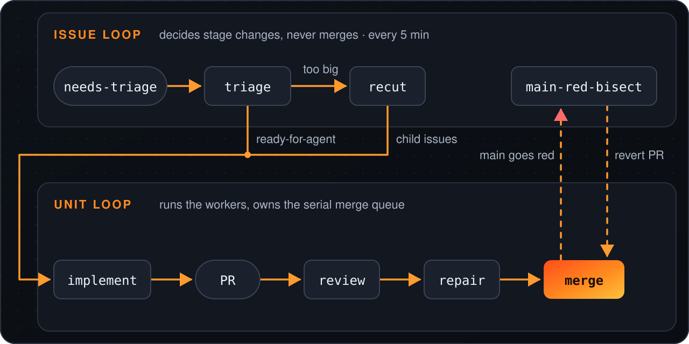
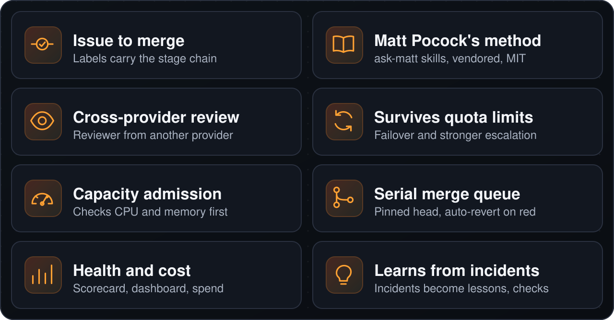

<p align="center">
  
</p>

<p align="center">
  <a href="https://www.npmjs.com/package/zenoforge"></a>
  <a href="LICENSE"></a>
  
</p>

<p align="center"><a href="#quickstart">Inicio rápido</a> · <a href="#cómo-funciona">Cómo funciona</a> · <a href="#qué-hace">Qué hace</a> · <a href="#antes-de-ejecutarlo">Seguridad</a> · <a href="#documentación">Documentación</a></p>

<p align="center"><a href="README.md">English</a> · <a href="README.zh-CN.md">简体中文</a> · <a href="README.ja.md">日本語</a> · <a href="README.ko.md">한국어</a> · <a href="README.es.md">Español</a></p>

Zenoforge es una fábrica de software autoalojada. Las CLI de agentes de programación que ya tienes (`codex`, `claude`, `zcode`) toman issues de un repositorio de GitHub y los llevan por triaje, implementación, revisión, reparación de CI y merge.

Está diseñado para funcionar sin supervisión y repararse solo. Hoy, algunos tickets todavía se dirigen a una persona, y eso es un hueco que hay que eliminar.

## Quickstart

<p align="center">
  
</p>

```bash
npx zenoforge doctor   # check the host first
npx zenoforge init     # guided setup for one repository
```

Luego etiqueta un issue con `needs-triage` para entregárselo a la fábrica. Necesitas Node 20+, `git`, un `gh` autenticado, `jq`, `python3`, `bash` 4+ y una CLI de agente; `doctor` los revisa todos.

<details>
<summary>Plataformas, qué hace <code>init</code>, comandos de operador</summary>

Linux, WSL2 y macOS funcionan (en macOS la CLI instala solo el bucle de unidades; ver [docs/install.md](docs/install.md)); Windows necesita WSL2.

`doctor` imprime una línea por requisito y el comando exacto de corrección para cualquier elemento que falte.

`init` pregunta qué repositorio usar y qué agente hace cada trabajo. Después crea un checkout dedicado, instala el motor en `~/.zenoforge/`, escribe la configuración con valores predeterminados seguros (2 workers, auto-merge solo cuando la protección de tu rama nombra los checks requeridos) y configura el programador. [docs/install.md](docs/install.md) enumera cada paso y la ruta manual.

`init` no añade `zenoforge` a tu PATH, así que ejecuta también los comandos de operador con `npx`:

```bash
npx zenoforge status      # scheduler, engine version, pipeline switches
npx zenoforge logs -f     # follow the engine logs
npx zenoforge stop        # scheduler off (start switches it on)
npx zenoforge rollback    # back to the previous engine version
```

`upgrade` y `uninstall` (`--purge` también borra `~/.zenoforge`) funcionan igual. Para scripts y CI, usa `init --repo owner/name --yes`; `--dry-run` imprime cada archivo que escribiría y cada comando que ejecutaría, y no cambia nada.

</details>

## Antes de ejecutarlo

> [!WARNING]
> Los agentes se ejecutan **sin sandbox**, con los permisos de tu usuario y tu sesión de `gh`. El texto de los issues es **entrada no confiable** que puede dirigirlos. Los cambios que pasan la revisión y los checks requeridos se **fusionan automáticamente**.
>
> Usa una cuenta de sistema operativo dedicada (o una máquina que puedas reconstruir), una cuenta de GitHub dedicada o un token de grano fino, y un repositorio donde solo puedan abrir issues las personas en las que confías. `init` te pide confirmarlo (o pasar `--yes`) antes de activar nada. Lee primero [SECURITY.md](SECURITY.md).

## Cómo funciona

<p align="center">
  
</p>

Dos bucles comparten las etiquetas de GitHub y el estado por issue. El bucle de issues (`engine/run-tick.sh`, cada 5 minutos) decide los cambios de etapa y nunca fusiona. El bucle de unidades (`engine/mac-autopilot/loop.sh`) ejecuta los workers y es dueño de la cola de merge en serie. Un tick solo decide e inicia workers desacoplados, y luego termina; el siguiente tick lee lo que dejaron. Consulta [docs/architecture.md](docs/architecture.md).

## Qué hace

<p align="center">
  
</p>

<details>
<summary>Detalles</summary>

- **Lleva un issue hasta el merge.** Los issues avanzan por una cadena de etapas fija: triage, recut, implement, self-check, review, repair y merge. Las etiquetas de GitHub llevan el estado.
- **Usa las habilidades de Matt Pocock como método.** Cada etapa sigue [las habilidades de Matt Pocock](https://github.com/mattpocock/skills), a las que se llega mediante `ask-matt`: triage, to-tickets, implement con tdd, diagnosing-bugs, code-review. Están incluidas en el repositorio (vendored) byte a byte bajo `.agents/skills/` y siguen bajo licencia MIT ([THIRD_PARTY_NOTICES.md](THIRD_PARTY_NOTICES.md)); ver [Arquitectura](docs/architecture.md#23-method-matt-skills).
- **Revisa entre proveedores.** La revisión debe usar un proveedor de modelos distinto al del implementador; cuando no hay ninguno disponible, se registra el fallback. La configuración incluida del bucle de unidades usa Claude para la revisión.
- **Sigue trabajando cuando se agota una cuota.** Una interfaz de worker sobre dos CLI de agentes de programación, Codex y ZCode, con circuit breakers, failover y escalado a un modelo más potente tras fallos repetidos.
- **Empieza el trabajo solo cuando el host puede asumirlo.** La admisión por capacidad revisa CPU y memoria antes de iniciar un worker, para que el host no se sobrecargue.
- **Fusiona un commit revisado a la vez.** Los merges fijan (pin) el SHA del head revisado y pasan por una cola de merge en serie. Cuando main se pone en rojo, el motor busca el commit culpable y lo revierte automáticamente.
- **Informa de salud y costo.** Un scorecard de salud del nodo con límites de sano y no sano, un dashboard y contabilidad de costo por ticket y de gasto en CI.
- **Aprende de los incidentes.** Los incidentes pueden convertirse en lecciones en el repositorio de destino, y el motor puede generar checks de cumplimiento a partir de ellas.

</details>

## Por qué Zenoforge

Zenoforge no es otro agente de programación. Es la fábrica alrededor de las CLI de agentes que ya usas: límites de capacidad, revisión con un segundo proveedor cuando hay uno disponible, una cola de merge en serie y revert automático cuando main se pone en rojo.

No es **para ti** si quieres un asistente dentro de tu editor, si no puedes aceptar que los agentes se ejecuten sin sandbox, o si necesitas uso comercial sin una licencia comercial (ver [Licencia](#licencia)).

## Estado

**Alfa.** Zenoforge se extrajo del pipeline que construye un producto en producción, donde se integran decenas de cambios escritos por agentes al día. El motor es real y está en funcionamiento; el empaquetado para otros repositorios es nuevo. Espera bordes sin pulir y mucho Bash.

Las etapas release, acceptance y advisor todavía no se distribuyen, así que la cadena de etapas termina en merge.

<details>
<summary>Qué falta, y las partes en chino</summary>

Faltan los runners de las etapas release, acceptance y advisor (por ejemplo `engine/run-release.sh`), y el proveedor de advisor no se incluye.

Partes del proyecto están en chino: la interfaz del dashboard, el correo al mantenedor, algunos módulos de prompt de workers (por ejemplo `engine/factory/common.md`) y muchos comentarios y cadenas de código. Unos 50 de los 230 archivos no de prueba bajo `engine/` y `tools/` contienen texto en chino. La traducción al inglés está prevista.

El mantenedor recibe correos para las decisiones.

</details>

## Documentación

- [Arquitectura](docs/architecture.md): los bucles, la cadena de etapas, los workers, los merges y el estado.
- [Instalación en un host](docs/install.md): qué hace `init` paso a paso, la ruta manual, la configuración, las unidades de systemd y lo que todavía no es genérico.
- [Seguridad](SECURITY.md): el modelo de amenazas. Los agentes se ejecutan sin sandbox y actúan sobre el texto de los issues.
- Fuente: `engine/` es el pipeline, `cli/` es el comando `zenoforge`, `tools/` son las herramientas del repositorio.

<details>
<summary>Ejecutar las pruebas</summary>

Ejecuta primero `npm ci`.

```bash
bash tools/run-engine-tests.sh      # all engine suites; add "0 8" for shard 0 of 8
node --test cli/*.test.mjs          # the zenoforge CLI
```

</details>

## Contribuir

Se aceptan contribuciones bajo el [Acuerdo de Licencia de Colaborador (CLA)](CLA.md). Consulta [CONTRIBUTING.md](CONTRIBUTING.md).

## Licencia

Zenoforge se distribuye bajo la [PolyForm Noncommercial License 1.0.0](LICENSE). Es **source-available** (código fuente disponible, solo uso no comercial), no aprobada por la OSI.

- Gratis para uso personal y no comercial.
- El uso comercial requiere una licencia comercial del mantenedor. Para pedirla, abre un issue en GitHub titulado "Commercial license" en [ZenoWangzy/zenoforge](https://github.com/ZenoWangzy/zenoforge/issues), o contacta al mantenedor a través de su [perfil de GitHub](https://github.com/ZenoWangzy).

La única excepción son las habilidades de Matt Pocock incluidas (vendored) bajo `.agents/skills/`, que siguen bajo la licencia MIT ([THIRD_PARTY_NOTICES.md](THIRD_PARTY_NOTICES.md)).
