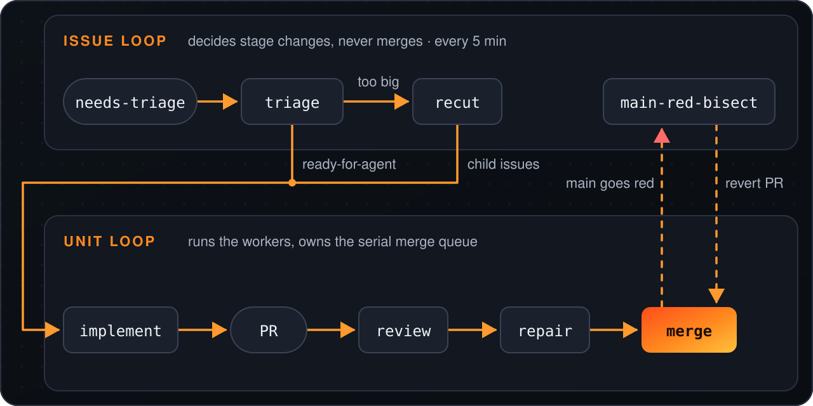
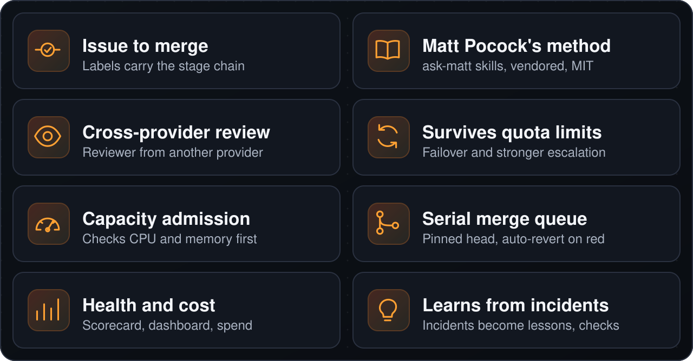

<p align="center">
  
</p>

<p align="center">
  <a href="https://www.npmjs.com/package/zenoforge"></a>
  <a href="LICENSE"></a>
  
</p>

<p align="center"><a href="#quickstart">Quickstart</a> · <a href="#仕組み">仕組み</a> · <a href="#主な機能">主な機能</a> · <a href="#実行する前に">セキュリティ</a> · <a href="#ドキュメント">ドキュメント</a></p>

<p align="center"><a href="README.md">English</a> · <a href="README.zh-CN.md">简体中文</a> · <a href="README.ja.md">日本語</a> · <a href="README.ko.md">한국어</a> · <a href="README.es.md">Español</a></p>

Zenoforge は、自己ホスト型のソフトウェアファクトリーです。すでに使っているコーディングエージェント CLI（`codex`、`claude`、`zcode`）が、1 つの GitHub リポジトリの Issue を triage、implement、review、repair、merge の各段階で処理します。

無人で動き、自己修復するように作られています。現時点では、一部のチケットがまだ人に回されており、これは解消すべき課題です。

## Quickstart

<p align="center">
  
</p>

```bash
npx zenoforge doctor   # check the host first
npx zenoforge init     # guided setup for one repository
```

次に Issue に `needs-triage` ラベルを付けると、ファクトリーに渡されます。必要なもの: Node 20 以上、`git`、認証済みの `gh`、`jq`、`python3`、Bash 4 以上、エージェント CLI 1 つ。`doctor` がこれらすべてを確認します。

<details>
<summary>対応プラットフォーム、<code>init</code> の処理内容、運用コマンド</summary>

Linux、WSL2、macOS で動作します（macOS では、CLI は unit loop のみをインストールします。[docs/install.md](docs/install.md) を参照）。Windows では WSL2 が必要です。

`doctor` は要件ごとに 1 行ずつ結果を表示し、不足しているものには修正用の正確なコマンドを表示します。

`init` は、使用するリポジトリと、どのエージェントがどの作業を担当するかを尋ねます。その後、専用のチェックアウトを作成し、エンジンを `~/.zenoforge/` 以下にインストールし、安全なデフォルト値（ワーカー 2 つ、ブランチ保護で必須チェックが指定されている場合のみ自動マージ）を設定ファイルに書き込み、スケジューラーを設定します。すべての手順と手動の方法は [docs/install.md](docs/install.md) に記載されています。

`init` は `zenoforge` を PATH に追加しないため、運用コマンドも `npx` 経由で実行してください:

```bash
npx zenoforge status      # scheduler, engine version, pipeline switches
npx zenoforge logs -f     # follow the engine logs
npx zenoforge stop        # scheduler off (start switches it on)
npx zenoforge rollback    # back to the previous engine version
```

`upgrade` と `uninstall`（`--purge` を付けると `~/.zenoforge` も削除）も同様に実行できます。スクリプトや CI では `init --repo owner/name --yes` を使ってください。`--dry-run` は書き込むすべてのファイルと実行するすべてのコマンドを表示しますが、何も変更しません。

</details>

## 実行する前に

> [!WARNING]
> エージェントは **サンドボックスなし** で、ユーザーの権限と `gh` のログインを使って動きます。Issue 内のテキストは、エージェントを誘導しうる **信頼できない入力** です。レビューと必須チェックを通過した変更は **自動的にマージ** されます。
>
> 専用の OS アカウント（または作り直せるマシン）、専用の GitHub アカウントまたは fine-grained token、そして Issue を作成できる人を信頼できる人だけに限ったリポジトリを使ってください。`init` は何かを有効にする前に、これを確認するよう求めます（`--yes` を指定すると省略できます）。まず [SECURITY.md](SECURITY.md) を読んでください。

## 仕組み

<p align="center">
  
</p>

2 つのループが、GitHub のラベルと Issue ごとの状態を共有します。Issue ループ（`engine/run-tick.sh`、5 分ごと）は段階の変更を判断し、マージは一切行いません。ユニットループ（`engine/mac-autopilot/loop.sh`）はワーカーを実行し、直列のマージキューを管理します。tick は判断して分離されたワーカーを起動するだけで終了し、次の tick が残された結果を読み取ります。詳しくは [docs/architecture.md](docs/architecture.md) を参照してください。

## 主な機能

<p align="center">
  
</p>

<details>
<summary>詳細</summary>

- **Issue を merge まで運びます。** Issue は固定の段階チェーンを進みます: triage、recut、implement、self-check、review、repair、merge。状態は GitHub のラベルで管理されます。
- **Matt Pocock のスキルを手法として使います。** すべての段階は [Matt Pocock のスキル](https://github.com/mattpocock/skills) に従い、`ask-matt` を通じて使われます: triage、to-tickets、tdd による implement、diagnosing-bugs、code-review。これらは `.agents/skills/` 以下にバイト単位で同一のままベンダリング（vendored）され、MIT ライセンスのままです（[THIRD_PARTY_NOTICES.md](THIRD_PARTY_NOTICES.md)）。[アーキテクチャ](docs/architecture.md#23-method-matt-skills) を参照してください。
- **プロバイダーをまたいでレビューします。** レビューは、実装者とは別のモデルプロバイダーを使う想定です。利用可能なものがない場合は、フォールバックを記録します。同梱の unit-loop 設定では、レビューに Claude を使います。
- **クォータが切れても作業を続けます。** 2 つのコーディングエージェント CLI（Codex と ZCode）を 1 つのワーカーインターフェースで扱い、サーキットブレーカー、フェイルオーバー、そして繰り返し失敗した場合のより強力なモデルへのエスカレーションを備えます。
- **ホストが引き受けられるときだけ作業を開始します。** キャパシティ審査は、ワーカーの起動前に CPU とメモリを確認し、ホストが過負荷にならないようにします。
- **レビュー済みのコミットを 1 つずつマージします。** マージはレビュー済みの head SHA に固定（pin）され、直列のマージキューを通ります。main が red になると、エンジンは原因となるコミットを探し、自動的に revert します。
- **健全性とコストを報告します。** 健全と不健全の境界を持つノードの健全性スコアカード、ダッシュボード、チケットごとのコストと CI 費用の集計を提供します。
- **インシデントから学習します。** インシデントは対象リポジトリの教訓になり、エンジンはそこから強制チェックを生成できます。

</details>

## なぜ Zenoforge か

Zenoforge は、別のコーディングエージェントではありません。すでに使っているエージェント CLI を取り巻く「ファクトリー」です。キャパシティ上限の管理、利用可能な場合の第 2 プロバイダーによるレビュー、直列のマージキュー、main が red になったときの自動 revert を提供します。

次のような場合は、**あなたには向いていません**: エディタ内のアシスタントが欲しい場合、サンドボックスなしでエージェントが動くことを受け入れられない場合、商用ライセンスなしで商用利用が必要な場合（[ライセンス](#ライセンス) を参照）。

## ステータス

**アルファ版です。** Zenoforge は、毎日何十件ものエージェントが書いた変更を取り込む本番プロダクトのパイプラインから切り出されました。エンジンは実際に稼働していますが、他のリポジトリ向けのパッケージングは新しいものです。粗い部分や Bash のスクリプトが残っていることを前提にしてください。

release、acceptance、advisor の段階は未提供のため、段階チェーンは merge で終わります。

<details>
<summary>不足している部分と、中国語で書かれた部分</summary>

release、acceptance、advisor 各段階のランナー（例: `engine/run-release.sh`）は含まれておらず、advisor プロバイダーも同梱されていません。

プロジェクトの一部は中国語で書かれています: ダッシュボードの UI、メンテナー宛てのメール、一部のワーカープロンプトモジュール（例: `engine/factory/common.md`）、そして多くのコードコメントと文字列。`engine/` と `tools/` 配下のテスト以外の 230 ファイルのうち、約 50 ファイルに中国語テキストが含まれます。英語への翻訳は予定されています。

メンテナーは、判断が必要な事項をメールで受け取ります。

</details>

## ドキュメント

- [アーキテクチャ](docs/architecture.md): ループ、段階チェーン、ワーカー、マージ、状態。
- [1 台のホストへのインストール](docs/install.md): `init` が手順ごとに行うこと、手動の方法、設定、systemd ユニット、まだ汎用化されていない部分。
- [セキュリティ](SECURITY.md): 脅威モデル。エージェントはサンドボックスなしで動作し、Issue のテキストに基づいて行動します。
- ソース: `engine/` はパイプライン、`cli/` は `zenoforge` コマンド、`tools/` はリポジトリのツールです。

<details>
<summary>テストを実行する</summary>

先に `npm ci` を実行してください。

```bash
bash tools/run-engine-tests.sh      # all engine suites; add "0 8" for shard 0 of 8
node --test cli/*.test.mjs          # the zenoforge CLI
```

</details>

## コントリビューション

コントリビューションは [Contributor License Agreement](CLA.md) のもとで歓迎します。[CONTRIBUTING.md](CONTRIBUTING.md) を参照してください。

## ライセンス

Zenoforge は [PolyForm Noncommercial License 1.0.0](LICENSE) のもとで提供されています。これは **source-available**（ソースコードは公開されているが、利用は非商用に限られる。OSI 承認のオープンソースライセンスではありません）です。

- 個人の非商用利用は無料です。
- 商用利用には、メンテナーからの商用ライセンスが必要です。お問い合わせは、タイトルを「Commercial license」とした GitHub Issue を [ZenoWangzy/zenoforge](https://github.com/ZenoWangzy/zenoforge/issues) に作成するか、メンテナーの [GitHub プロフィール](https://github.com/ZenoWangzy) から連絡してください。

例外は、`.agents/skills/` 以下にベンダリングされた Matt Pocock のスキルで、これは MIT ライセンスのままです（[THIRD_PARTY_NOTICES.md](THIRD_PARTY_NOTICES.md)）。
