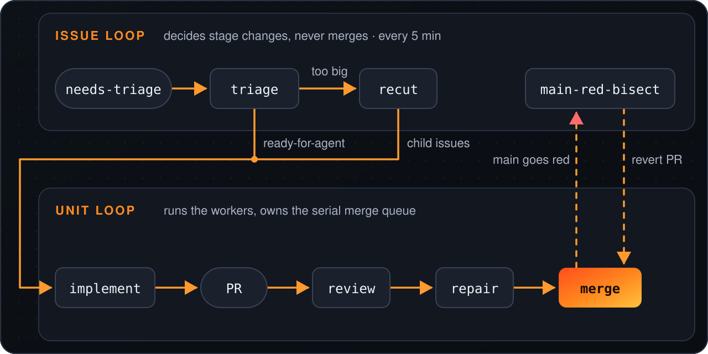
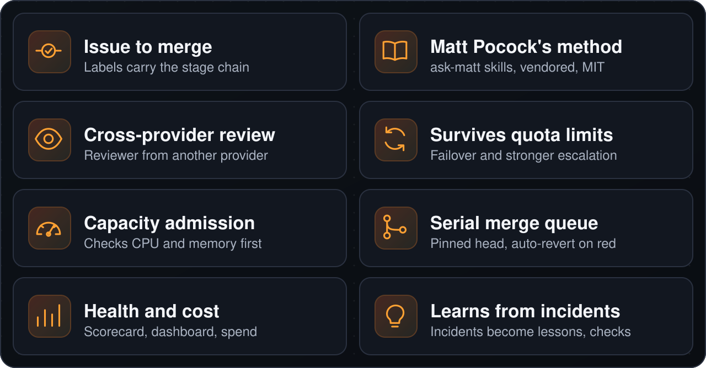

<p align="center">
  
</p>

<p align="center">
  <a href="https://www.npmjs.com/package/zenoforge"></a>
  <a href="LICENSE"></a>
  
</p>

<p align="center"><a href="#quickstart">빠른 시작</a> · <a href="#작동-방식">작동 방식</a> · <a href="#주요-기능">주요 기능</a> · <a href="#실행-전-확인">보안</a> · <a href="#문서">문서</a></p>

<p align="center"><a href="README.md">English</a> · <a href="README.zh-CN.md">简体中文</a> · <a href="README.ja.md">日本語</a> · <a href="README.ko.md">한국어</a> · <a href="README.es.md">Español</a></p>

Zenoforge는 셀프 호스팅 소프트웨어 팩토리입니다. 이미 가지고 있는 코딩 에이전트 CLI(`codex`, `claude`, `zcode`)가 하나의 GitHub 저장소에 있는 이슈를 triage, implement, review, repair, merge 단계까지 처리합니다.

사람의 개입 없이 돌아가고 스스로 복구하도록 설계되었습니다. 현재는 일부 티켓이 아직 사람에게 넘어가는데, 이는 없애야 할 공백입니다.

## Quickstart

<p align="center">
  
</p>

```bash
npx zenoforge doctor   # check the host first
npx zenoforge init     # guided setup for one repository
```

그다음 이슈에 `needs-triage` 라벨을 붙이면 팩토리로 넘어갑니다. Node 20+, `git`, 인증된 `gh`, `jq`, `python3`, `bash` 4+ 및 에이전트 CLI 하나가 필요하며, `doctor`가 이 항목을 모두 확인합니다.

<details>
<summary>지원 플랫폼, <code>init</code>이 하는 일, 운영 명령어</summary>

Linux, WSL2, macOS에서 동작합니다(macOS에서는 CLI가 unit loop만 설치합니다. [docs/install.md](docs/install.md) 참고). Windows에는 WSL2가 필요합니다.

`doctor`는 요구 사항마다 한 줄씩 출력하며, 누락된 항목에 대해서는 정확한 수정 명령을 함께 보여줍니다.

`init`은 사용할 저장소와 각 작업을 맡을 에이전트를 묻습니다. 그다음 전용 체크아웃을 만들고, 엔진을 `~/.zenoforge/` 아래에 설치하며, 안전한 기본값(워커 2개, 브랜치 보호에 필수 체크가 명시된 경우에만 자동 머지)으로 설정 파일을 작성하고 스케줄러를 설정합니다. 모든 단계와 수동 설치 방법은 [docs/install.md](docs/install.md)에 나와 있습니다.

`init`은 `zenoforge`를 PATH에 등록하지 않으므로, 운영 명령도 `npx`로 실행하세요:

```bash
npx zenoforge status      # scheduler, engine version, pipeline switches
npx zenoforge logs -f     # follow the engine logs
npx zenoforge stop        # scheduler off (start switches it on)
npx zenoforge rollback    # back to the previous engine version
```

`upgrade`와 `uninstall`도 같은 방식으로 동작합니다(`--purge`를 붙이면 `~/.zenoforge`도 삭제됩니다). 스크립트와 CI에서는 `init --repo owner/name --yes`를 사용하세요. `--dry-run`은 작성할 모든 파일과 실행할 모든 명령을 출력하며, 아무것도 바꾸지 않습니다.

</details>

## 실행 전 확인

> [!WARNING]
> 에이전트는 **샌드박스 없이** 사용자 권한과 `gh` 로그인으로 실행됩니다. 이슈의 텍스트는 에이전트의 방향을 바꿀 수 있는 **신뢰할 수 없는 입력**입니다. 리뷰와 필수 체크를 통과한 변경은 **자동으로 머지**됩니다.
>
> 전용 OS 계정(또는 언제든 다시 만들 수 있는 머신), 전용 GitHub 계정 또는 fine-grained 토큰, 그리고 신뢰하는 사람만 이슈를 등록할 수 있는 저장소를 사용하세요. `init`은 무엇이든 켜기 전에 이를 확인하도록 요청합니다(또는 `--yes` 전달). 먼저 [SECURITY.md](SECURITY.md)를 읽어 보세요.

## 작동 방식

<p align="center">
  
</p>

두 루프는 GitHub 라벨과 이슈별 상태를 공유합니다. 이슈 루프(`engine/run-tick.sh`, 5분마다)는 단계 전환을 결정하며 절대 머지하지 않습니다. 유닛 루프(`engine/mac-autopilot/loop.sh`)는 워커를 실행하고 직렬 머지 큐를 관리합니다. 틱은 결정만 하고 분리된 워커를 시작한 뒤 종료하며, 다음 틱이 워커가 남긴 결과를 읽습니다. [docs/architecture.md](docs/architecture.md)를 참고하세요.

## 주요 기능

<p align="center">
  
</p>

<details>
<summary>자세한 내용</summary>

- **이슈를 머지까지 처리합니다.** 이슈는 고정된 단계 체인(triage, recut, implement, self-check, review, repair, merge)을 따라 이동합니다. 상태는 GitHub 라벨로 관리됩니다.
- **방법론으로 Matt Pocock의 스킬을 사용합니다.** 모든 단계는 [Matt Pocock의 스킬](https://github.com/mattpocock/skills)을 따르며, `ask-matt`를 통해 진입합니다: triage, to-tickets, implement with tdd, diagnosing-bugs, code-review. 이 스킬들은 `.agents/skills/` 아래에 바이트 단위로 동일하게 벤더링되어 있으며 MIT 라이선스를 유지합니다([THIRD_PARTY_NOTICES.md](THIRD_PARTY_NOTICES.md)). [아키텍처](docs/architecture.md#23-method-matt-skills)를 참고하세요.
- **공급자를 가로질러 리뷰합니다.** 리뷰는 구현을 맡은 것과 다른 모델 공급자를 사용하도록 되어 있으며, 사용할 수 있는 공급자가 없으면 대체 수단을 기록합니다. 기본 제공되는 유닛 루프 설정은 리뷰에 Claude를 사용합니다.
- **쿼터가 소진되어도 계속 동작합니다.** Codex와 ZCode 두 코딩 에이전트 CLI를 하나의 워커 인터페이스로 다루며, 서킷 브레이커, 페일오버, 반복 실패 시 더 강한 모델로의 에스컬레이션을 지원합니다.
- **호스트가 감당할 수 있을 때만 작업을 시작합니다.** 용량 admission이 워커를 시작하기 전에 CPU와 메모리를 확인하므로 호스트가 과부하되지 않습니다.
- **리뷰를 마친 커밋을 한 번에 하나씩 머지합니다.** 머지는 리뷰된 head SHA에 고정되고 직렬 머지 큐를 거칩니다. main이 빨갛게 되면 엔진이 원인 커밋을 찾아 자동으로 되돌립니다.
- **상태와 비용을 보고합니다.** 정상/비정상 기준이 있는 노드 상태 스코어카드, 대시보드, 티켓별 비용과 CI 지출 집계를 제공합니다.
- **장애에서 배웁니다.** 장애는 대상 저장소의 교훈으로 남을 수 있으며, 엔진은 이를 바탕으로 강제 검사를 생성할 수 있습니다.

</details>

## Zenoforge를 선택하는 이유

Zenoforge는 또 하나의 코딩 에이전트가 아닙니다. 이미 실행 중인 에이전트 CLI를 둘러싼 팩토리입니다. 용량 한도, 가능한 경우 두 번째 공급자 리뷰, 직렬 머지 큐, main이 빨갛게 되면 자동 되돌리기를 제공합니다.

에디터 안의 어시스턴트를 원하거나, 샌드박스 없이 에이전트가 실행되는 것을 받아들일 수 없거나, 상업 라이선스 없이 상업적으로 쓰려는 경우라면 **이 프로젝트는 맞지 않습니다** ([라이선스](#라이선스) 참고).

## 상태

**Alpha.** Zenoforge는 실제 제품을 빌드하는 파이프라인에서 분리되었으며, 그 파이프라인에서는 하루에도 수십 건의 에이전트 작성 변경이 반영됩니다. 엔진은 실제로 동작 중이고, 다른 저장소를 위한 패키징은 새로 만든 것입니다. 거친 부분과 Bash 스크립트가 많다는 점을 감안하세요.

release, acceptance, advisor 단계는 아직 제공되지 않으므로 단계 체인은 merge에서 끝납니다.

<details>
<summary>빠진 부분과 중국어 관련 내용</summary>

release, acceptance, advisor 단계의 러너(예: `engine/run-release.sh`)가 없고, advisor 공급자도 제공되지 않습니다.

프로젝트 일부는 중국어로 작성되어 있습니다. 대시보드 UI, 메인테이너 메일, 일부 워커 프롬프트 모듈(예: `engine/factory/common.md`), 그리고 많은 코드 주석과 문자열이 그렇습니다. `engine/`과 `tools/` 아래 테스트가 아닌 파일 230개 중 약 50개에 중국어 텍스트가 들어 있습니다. 영어 번역은 계획되어 있습니다.

결정이 필요한 사항은 메인테이너에게 메일로 전달됩니다.

</details>

## 문서

- [아키텍처](docs/architecture.md): 루프, 단계 체인, 워커, 머지, 상태.
- [단일 호스트에 설치](docs/install.md): `init`이 단계별로 하는 일, 수동 설치 경로, 설정, systemd 유닛, 아직 범용화되지 않은 부분.
- [보안](SECURITY.md): 위협 모델. 에이전트는 샌드박스 없이 실행되며 이슈 텍스트에 따라 행동합니다.
- 소스: `engine/`은 파이프라인, `cli/`는 `zenoforge` 명령, `tools/`는 저장소 도구입니다.

<details>
<summary>테스트 실행</summary>

먼저 `npm ci`를 실행하세요.

```bash
bash tools/run-engine-tests.sh      # all engine suites; add "0 8" for shard 0 of 8
node --test cli/*.test.mjs          # the zenoforge CLI
```

</details>

## 기여 방법

기여는 [기여자 라이선스 계약(CLA)](CLA.md)에 따라 환영합니다. [CONTRIBUTING.md](CONTRIBUTING.md)를 참고하세요.

## 라이선스

Zenoforge는 [PolyForm Noncommercial License 1.0.0](LICENSE)에 따라 라이선스가 부여됩니다. **source-available**(소스 공개, 비상업적 사용 한정)이며, OSI 승인을 받은 라이선스가 아닙니다.

- 개인적·비상업적 용도로는 무료입니다.
- 상업적 용도로 사용하려면 메인테이너의 상업 라이선스가 필요합니다. 문의하려면 [ZenoWangzy/zenoforge](https://github.com/ZenoWangzy/zenoforge/issues)에 "Commercial license"라는 제목으로 GitHub 이슈를 열거나, 메인테이너의 [GitHub 프로필](https://github.com/ZenoWangzy)을 통해 연락하세요.

예외는 `.agents/skills/` 아래에 벤더링된 Matt Pocock 스킬뿐이며, 이것은 MIT 라이선스([THIRD_PARTY_NOTICES.md](THIRD_PARTY_NOTICES.md))를 따릅니다.
