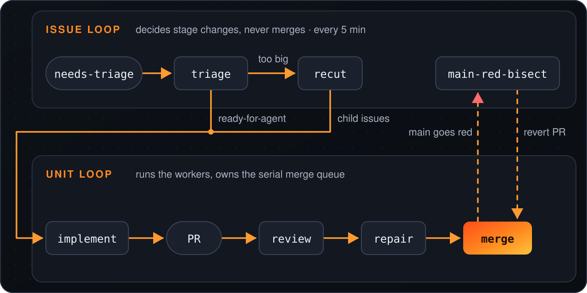
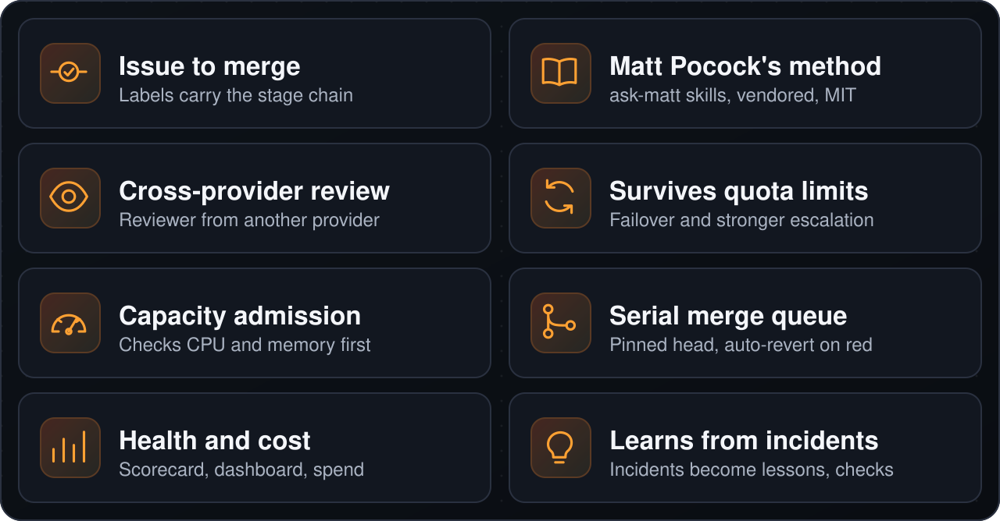

<p align="center">
  
</p>

<p align="center">
  <a href="https://www.npmjs.com/package/zenoforge"></a>
  <a href="LICENSE"></a>
  
</p>

<p align="center"><a href="#quickstart">Quickstart</a> · <a href="#how-it-works">How it works</a> · <a href="#what-it-does">What it does</a> · <a href="#before-you-run-it">Security</a> · <a href="#documentation">Docs</a></p>

<p align="center"><a href="README.md">English</a> · <a href="README.zh-CN.md">简体中文</a> · <a href="README.ja.md">日本語</a> · <a href="README.ko.md">한국어</a> · <a href="README.es.md">Español</a></p>

Zenoforge is a self-hosted software factory. The coding-agent CLIs you already have (`codex`, `claude`, `zcode`) take issues in one GitHub repository through triage, implementation, review, CI repair and merge.

It is built to run unattended and heal itself. Today some tickets are still routed to a person, which is a gap to remove.

## Quickstart

<p align="center">
  
</p>

```bash
npx zenoforge doctor   # check the host first
npx zenoforge init     # guided setup for one repository
```

Then label an issue `needs-triage` to hand it to the factory. You need Node 20+, `git`, an authenticated `gh`, `jq`, `python3`, `bash` 4+ and one agent CLI; `doctor` checks them all.

<details>
<summary>Platforms, what <code>init</code> does, operator commands</summary>

Linux, WSL2 and macOS work (on macOS the CLI installs the unit loop only, see [docs/install.md](docs/install.md)); Windows needs WSL2.

`doctor` prints one line per requirement, and the exact fix command for anything missing.

`init` asks which repository to use and which agent does which job. It then creates a dedicated checkout, installs the engine under `~/.zenoforge/`, writes the config with safe defaults (2 workers, auto-merge only when your branch protection names required checks) and sets up the scheduler. [docs/install.md](docs/install.md) lists every step and the manual path.

`init` does not put `zenoforge` on your PATH, so run the operator commands through `npx` as well:

```bash
npx zenoforge status      # scheduler, engine version, pipeline switches
npx zenoforge logs -f     # follow the engine logs
npx zenoforge stop        # scheduler off (start switches it on)
npx zenoforge rollback    # back to the previous engine version
```

`upgrade` and `uninstall` (`--purge` also deletes `~/.zenoforge`) work the same way. For scripts and CI, use `init --repo owner/name --yes`; `--dry-run` prints every file it would write and every command it would run, and changes nothing.

</details>

## Before you run it

> [!WARNING]
> The agents run **unsandboxed**, with your user's permissions and your `gh` login. Text in issues is **untrusted input** that can steer them. Changes that pass review and required checks are **merged automatically**.
>
> Use a dedicated OS account (or a machine you can rebuild), a dedicated GitHub account or a fine-grained token, and a repository where only people you trust can file issues. `init` asks you to confirm this (or pass `--yes`) before it switches anything on. Read [SECURITY.md](SECURITY.md) first.

## How it works

<p align="center">
  
</p>

Two loops share GitHub labels and per-issue state. The issue loop (`engine/run-tick.sh`, every 5 minutes) decides stage changes and never merges. The unit loop (`engine/mac-autopilot/loop.sh`) runs the workers and owns the serial merge queue. A tick only decides and starts detached workers, then exits; the next tick reads what they left. See [docs/architecture.md](docs/architecture.md).

## What it does

<p align="center">
  
</p>

<details>
<summary>Details</summary>

- **Takes an issue to a merge.** Issues move through a fixed stage chain: triage, recut, implement, self-check, review, repair, and merge. GitHub labels carry the state.
- **Uses Matt Pocock's skills as its method.** Every stage follows [Matt Pocock's skills](https://github.com/mattpocock/skills), entered through `ask-matt`: triage, to-tickets, implement with tdd, diagnosing-bugs, code-review. They are vendored byte-identical under `.agents/skills/` and stay MIT ([THIRD_PARTY_NOTICES.md](THIRD_PARTY_NOTICES.md)); see [Architecture](docs/architecture.md#23-method-matt-skills).
- **Reviews across providers.** Review is meant to use a different model provider from the implementer; when none is available, the fallback is recorded. The shipped unit-loop config uses Claude for review.
- **Keeps working when a quota runs out.** One worker interface over two coding-agent CLIs, Codex and ZCode, with circuit breakers, failover, and escalation to a stronger model after repeated failures.
- **Starts work only when the host can take it.** Capacity admission checks CPU and memory before a worker starts, so the host is not overloaded.
- **Merges one reviewed commit at a time.** Merges pin the reviewed head SHA and go through a serial merge queue. When main goes red, the engine searches for the culprit commit and reverts it automatically.
- **Reports health and cost.** A node health scorecard with healthy and unhealthy bounds, a dashboard, and per-ticket cost and CI-spend accounting.
- **Learns from incidents.** Incidents can become lessons in the target repository, and the engine can generate enforcement checks from them.

</details>

## Why Zenoforge

Zenoforge is not another coding agent. It is the factory around the agent CLIs you already run: capacity limits, a second-provider review where one is available, a serial merge queue, and automatic revert when main turns red.

It is **not for you** if you want an assistant inside your editor, if you cannot accept agents running without a sandbox, or if you need commercial use without a commercial license (see [License](#license)).

## Status

**Alpha.** Zenoforge was extracted from the pipeline that builds a production product, where it lands dozens of agent-written changes a day. The engine is real and running; the packaging for other repositories is new. Expect rough edges and Bash.

The release, acceptance and advisor stages are not shipped, so the stage chain ends at merge.

<details>
<summary>What is missing, and the Chinese-language parts</summary>

The runners for the release, acceptance and advisor stages (for example `engine/run-release.sh`) are absent, and the advisor provider does not ship.

Parts of the project are in Chinese: the dashboard UI, the maintainer mail, some worker prompt modules (for example `engine/factory/common.md`), and many code comments and strings. About 50 of the 230 non-test files under `engine/` and `tools/` contain Chinese text. English translation is planned.

The maintainer gets mail for decisions.

</details>

## Documentation

- [Architecture](docs/architecture.md): the loops, stage chain, workers, merging and state.
- [Installing on one host](docs/install.md): what `init` does step by step, the manual path, configuration, systemd units, and what is not generic yet.
- [Security](SECURITY.md): the threat model. Agents run unsandboxed and act on issue text.
- Source: `engine/` is the pipeline, `cli/` is the `zenoforge` command, `tools/` is repository tooling.

<details>
<summary>Run the tests</summary>

Run `npm ci` first.

```bash
bash tools/run-engine-tests.sh      # all engine suites; add "0 8" for shard 0 of 8
node --test cli/*.test.mjs          # the zenoforge CLI
```

</details>

## Contributing

Contributions are welcome under the [Contributor License Agreement](CLA.md). See [CONTRIBUTING.md](CONTRIBUTING.md).

## License

Zenoforge is licensed under the [PolyForm Noncommercial License 1.0.0](LICENSE). It is **source-available**, not OSI-approved.

- Free for personal, noncommercial use.
- Commercial use requires a commercial license from the maintainer. To ask, open a GitHub issue titled "Commercial license" in [ZenoWangzy/zenoforge](https://github.com/ZenoWangzy/zenoforge/issues), or contact the maintainer through the maintainer's [GitHub profile](https://github.com/ZenoWangzy).

The one exception is the vendored Matt Pocock skills under `.agents/skills/`, which stay under the MIT License ([THIRD_PARTY_NOTICES.md](THIRD_PARTY_NOTICES.md)).
