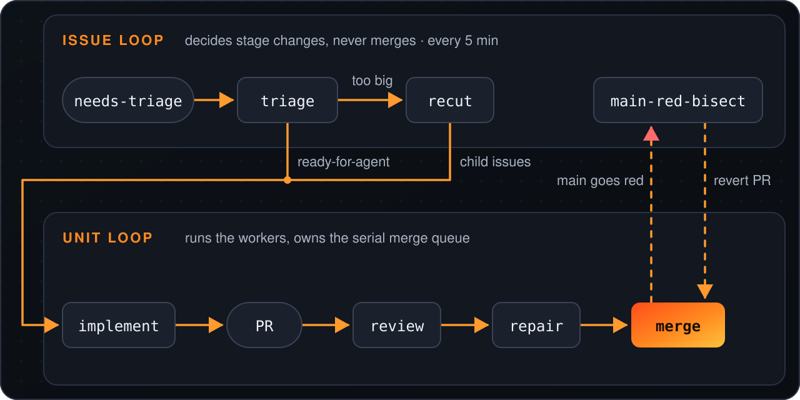
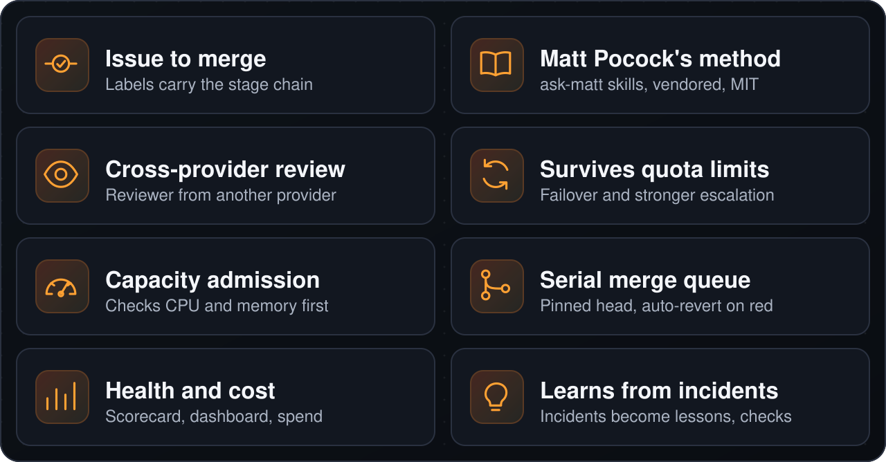

<p align="center">
  
</p>

<p align="center">
  <a href="https://www.npmjs.com/package/zenoforge"></a>
  <a href="LICENSE"></a>
  
</p>

<p align="center"><a href="#quickstart">快速开始</a> · <a href="#工作原理">工作原理</a> · <a href="#功能概览">功能概览</a> · <a href="#运行前须知">安全</a> · <a href="#文档">文档</a></p>

<p align="center"><a href="README.md">English</a> · <a href="README.zh-CN.md">简体中文</a> · <a href="README.ja.md">日本語</a> · <a href="README.ko.md">한국어</a> · <a href="README.es.md">Español</a></p>

Zenoforge 是一个自托管的软件工厂。你已经在用的 coding-agent CLI（`codex`、`claude`、`zcode`）可以处理同一个 GitHub 仓库中的 issue，依次经过 triage、implement、review、repair 和 merge 等阶段。

它的设计目标是无人值守、自我修复。目前仍有部分工单会转交给人工处理，这是需要消除的缺口。

## Quickstart

<p align="center">
  
</p>

```bash
npx zenoforge doctor   # check the host first
npx zenoforge init     # guided setup for one repository
```

然后给 issue 加上 `needs-triage` 标签，即可交给工厂处理。你需要 Node 20+、`git`、已登录的 `gh`、`jq`、`python3`、`bash` 4+ 以及一个 agent CLI；`doctor` 会检查所有这些依赖。

<details>
<summary>平台支持、<code>init</code> 做了什么、运维命令</summary>

Linux、WSL2 和 macOS 可以使用（macOS 上 CLI 只安装 unit 循环，见 [docs/install.md](docs/install.md)）；Windows 需要 WSL2。

`doctor` 为每项要求输出一行，缺失项会给出确切的修复命令。

`init` 会询问使用哪个仓库，以及由哪个 agent 负责哪项工作。随后它会创建专用 checkout，把引擎安装到 `~/.zenoforge/` 下，以安全的默认值写入配置（2 个 worker；仅当分支保护规则指定了必需检查时才自动合并），并设置调度器。[docs/install.md](docs/install.md) 列出了每一步以及手动安装路径。

`init` 不会把 `zenoforge` 加入你的 PATH，因此运维命令也需通过 `npx` 运行：

```bash
npx zenoforge status      # scheduler, engine version, pipeline switches
npx zenoforge logs -f     # follow the engine logs
npx zenoforge stop        # scheduler off (start switches it on)
npx zenoforge rollback    # back to the previous engine version
```

`upgrade` 和 `uninstall`（`--purge` 还会删除 `~/.zenoforge`）用法相同。在脚本和 CI 中，使用 `init --repo owner/name --yes`；`--dry-run` 会打印它将写入的每个文件和将运行的每条命令，但不做任何更改。

</details>

## 运行前须知

> [!WARNING]
> agent 以**无沙箱**方式运行，使用你的用户权限和你的 `gh` 登录态。issue 中的文本是**不可信输入**，可能诱导它们做出错误操作。通过评审和必需检查的变更会被**自动合并**。
>
> 请使用专用的操作系统账户（或可随时重装的机器）、专用的 GitHub 账户或细粒度 token，并且只使用仅受信任的人员可以提交 issue 的仓库。`init` 在开启任何功能之前会要求你确认这一点（或传入 `--yes`）。请先阅读 [SECURITY.md](SECURITY.md)。

## 工作原理

<p align="center">
  
</p>

两个循环共享 GitHub 标签和每个 issue 的状态。issue 循环（`engine/run-tick.sh`，每 5 分钟运行一次）负责决定阶段变更，且从不合并。unit 循环（`engine/mac-autopilot/loop.sh`）负责运行 worker，并管理串行合并队列。每个 tick 只做决定并启动分离的 worker，然后退出；下一个 tick 读取它们留下的结果。参见 [架构文档](docs/architecture.md)。

## 功能概览

<p align="center">
  
</p>

<details>
<summary>详情</summary>

- **从 issue 一路推进到合并。** issue 按固定的阶段链推进：triage、recut、implement、self-check、review、repair、merge。状态由 GitHub 标签承载。
- **以 Matt Pocock 的 skills 作为方法论。** 每个阶段都遵循 [Matt Pocock 的 skills](https://github.com/mattpocock/skills)，通过 `ask-matt` 进入：triage、to-tickets、implement（配合 tdd）、diagnosing-bugs、code-review。它们以逐字节一致的方式内置于 `.agents/skills/`，并保持 MIT 许可（[THIRD_PARTY_NOTICES.md](THIRD_PARTY_NOTICES.md)）；参见 [架构](docs/architecture.md#23-method-matt-skills)。
- **跨 provider 评审。** 评审应使用与实现者不同的模型 provider；若没有可用的 provider，则记录回退情况。随附的 unit 循环配置使用 Claude 做评审。
- **配额用尽后仍能继续工作。** 对 Codex 和 ZCode 两个 coding-agent CLI 提供统一的 worker 接口，带有熔断器、故障转移，并在反复失败后升级到更强的模型。
- **只在主机有余力时才开始工作。** 容量准入会在 worker 启动前检查 CPU 和内存，避免主机过载。
- **每次只合并一个经过评审的提交。** 合并会固定到经评审的 head SHA，并通过串行合并队列进行。main 变红时，引擎会查找罪魁提交（culprit commit）并自动 revert。
- **报告健康状况与成本。** 节点健康评分卡（含健康与不健康的阈值范围）、仪表盘，以及按工单统计的成本和 CI 支出。
- **从事故中学习。** 事故可以沉淀为目标仓库中的经验教训，引擎还能据此生成强制检查。

</details>

## 为什么选择 Zenoforge

Zenoforge 不是又一个 coding agent。它是包裹在你已在运行的 agent CLI 外面的工厂：容量限制、（若有可用的）第二 provider 评审、串行合并队列，以及 main 变红时自动 revert。

如果你想要编辑器里的助手、无法接受 agent 在无沙箱环境下运行，或者需要商业使用却没有商业许可，那么它**不适合你**（见 [许可证](#许可证)）。

## 状态

**Alpha。** Zenoforge 是从一条为生产产品构建代码的流水线中提取出来的，该流水线每天落地数十个由 agent 编写的变更。引擎是真实运行的；面向其他仓库的打包方式则是新的。预计会有粗糙的地方，并且会大量用到 Bash。

release、acceptance 和 advisor 阶段尚未发布，因此阶段链终止于 merge。

<details>
<summary>缺失的部分与中文内容</summary>

release、acceptance 和 advisor 阶段的运行器（例如 `engine/run-release.sh`）尚未提供，advisor provider 也未随项目发布。

项目的一部分内容是中文的：仪表盘 UI、维护者邮件、部分 worker 提示词模块（例如 `engine/factory/common.md`），以及许多代码注释和字符串。`engine/` 和 `tools/` 下 230 个非测试文件中，约 50 个包含中文文本。计划提供英文翻译。

需要决策时，维护者会收到邮件。

</details>

## 文档

- [架构](docs/architecture.md)：循环、阶段链、worker、合并与状态。
- [单机安装](docs/install.md)：`init` 逐步做了什么、手动安装路径、配置、systemd 单元，以及目前尚未通用化的部分。
- [安全](SECURITY.md)：威胁模型。agent 无沙箱运行，并依据 issue 文本行动。
- 源码：`engine/` 是流水线，`cli/` 是 `zenoforge` 命令，`tools/` 是仓库工具。

<details>
<summary>运行测试</summary>

请先运行 `npm ci`。

```bash
bash tools/run-engine-tests.sh      # all engine suites; add "0 8" for shard 0 of 8
node --test cli/*.test.mjs          # the zenoforge CLI
```

</details>

## 参与贡献

欢迎贡献代码，贡献需遵守[贡献者许可协议](CLA.md)。详见 [CONTRIBUTING.md](CONTRIBUTING.md)。

## 许可证

Zenoforge 依 [PolyForm Noncommercial License 1.0.0](LICENSE) 授权。它是 **source-available**（源码可见）许可，并非 OSI 认证的许可证。

- 允许个人、非商业用途，免费使用。
- 商业用途需要向维护者申请商业许可。申请方式：在 [ZenoWangzy/zenoforge](https://github.com/ZenoWangzy/zenoforge/issues) 中新建一个标题为 "Commercial license" 的 GitHub issue，或通过维护者的 [GitHub 主页](https://github.com/ZenoWangzy) 联系维护者。

唯一的例外是 `.agents/skills/` 下内置的 Matt Pocock skills，它们仍适用 MIT 许可（[THIRD_PARTY_NOTICES.md](THIRD_PARTY_NOTICES.md)）。
